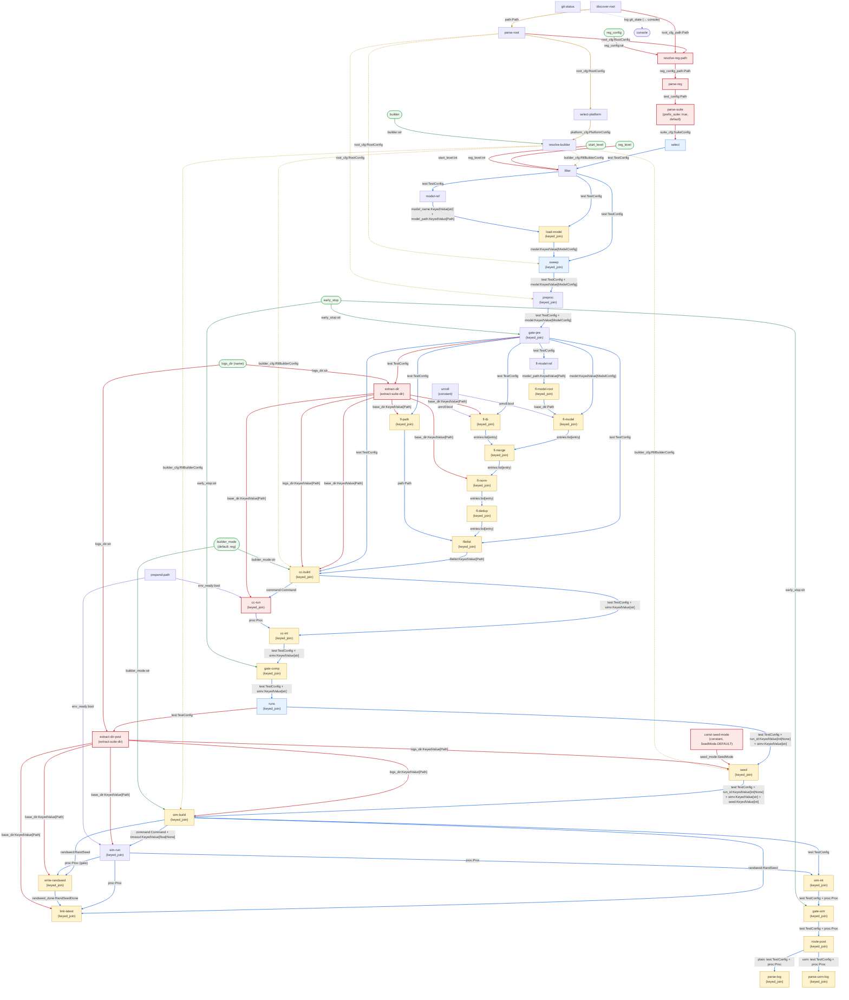

# `regression` Graph Dataflow Diagram

[Back to the `regression` graph](regression.md) · [graphs index](index.md)

The full dataflow of the `regression` graph, rendered inline by GitHub. Node labels note the pairing contract in parentheses; edge labels show the payloads carried (`port:Type`, with `#124;` rendering as `|`). Colour key: solid blue = main line, amber dashed = persistent config, purple = env, green = CLI inputs, red = delta nodes/edges (new or rewired vs [`test`](test-dataflow-diagram.md)).

